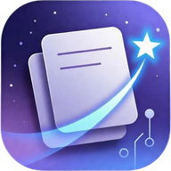

<div align="center">



# ✦ 星 叙 ✦
### Star Narration · xint

*让每一个灵感都有机会长成作品*

[](https://1338032.github.io/Star.Narration.xint/)
[](https://1338032.github.io/Star.Narration.xint/)
[](https://1338032.github.io/Star.Narration.xint/)
[](https://1338032.github.io/Star.Narration.xint/)

<br/>

**[🌐 立即使用](https://1338032.github.io/Star.Narration.xint/)** · **[📦 下载 APK](https://1338032.github.io/Star.Narration.xint/syn.apk)** · **[📖 使用指南](https://1338032.github.io/Star.Narration.xint/md/Basic-Tutorial.md)** · **[📄 项目白皮书](./WHITEPAPER.md)**

<br/>

> 星叙是一款专为**网文创作者**打造的智能写作工具。  
> 无需注册、数据本地存储、永久免费——你的故事，由你掌控。

</div>

---

## 📢 星叙的创作立场声明

**星叙从诞生之初，就明确反对**用 AI 批量生成低质内容、刷平台、代笔代写等行为。

我开发这个工具的初心，**不是为了让 AI 代替人类写作**，而是希望给真正热爱创作的人，提供一个**强大、私密、好用的辅助创作工作室**。

我坚信：

> **好的故事永远来自作者的真情实感、人生经历和独特思考，AI 无法取代。**

AI 应该是创作者的**“灵感伙伴”**和**“高效助手”**，而不是写作的主体。

最终呈现在读者面前的每一部作品，都应该由**作者本人**主导把控、修改打磨，并对内容负责。

星叙的所有功能设计（伏笔追踪、精华压缩器、星笺、世界观管理、版本历史等），都是为了帮助作者**更好地思考、更好地规划、更好地完善**自己的故事，而不是一键生成完事。

**如果您也认同“人类创作 + AI 辅助”的理念**，欢迎使用星叙。  

**如果您期待的是完全由 AI 自动生成小说然后直接发布的工具**，那么星叙**并不适合您**。

我会继续把星叙做成一个**尊重创作者、尊重原创**的工具，也欢迎大家在合理使用的前提下，一起维护健康、良性的创作生态。

---

## 🆕 更新记录

### v1.5.1（2026.10.20）

本轮重点是世界地图、人物肖像、数据安全和长篇创作工作流。

- **世界地图**：在局部世界观下方上传图片并按 16:9 裁剪；进入横向地图编辑视图，双指缩放、拖动平移。可绘制彩色多边形分区、添加地点戳、连接地区/地点并编辑名称与内容；编辑模式下可长按移动地点，关系线跟随端点变化，点击地区内部即可编辑。支持文字设定启用、最多 30 步撤回、保留底图的标注清空、未保存退出确认和保存退出，地图编辑随对应预设保存。
- **人物肖像与角色卡片**：角色卡片可翻转查看肖像，默认展示设定面，翻转恢复 3:4 比例；NPC 在编辑弹窗上传照片，列表左图右文。角色、NPC、关系页面新增搜索，性格标签默认折叠显示已选项。
- **关系网肖像模式**：可将天体节点切换为居中裁切的人物肖像，保持原形和大小；人物信息卡有肖像即显示，不受模式开关影响。重置、编辑与删除等操作简化为图标。
- **毛玻璃与动效**：小说/资源卡片采用透明磨砂，搜索框/创作工具箱采用渐变透明；页面美化新增默认开启的总开关，关闭恢复普通样式。有封面的长篇只处理下方信息区，不处理封面。设置搜索、批量管理及折叠栏增加平滑过渡，全屏开关与其他开关右对齐。
- **ZIP 完整备份与回收站**：完整备份按类别分文件打包 ZIP，支持直接导入及旧 JSON 备份兼容；可读取压缩包内的单个损坏文件不阻断其他正常文件导入，并提示损坏数量。原「导出创作数据」入口替换为七天作品回收站，提供全屏搜索、类别筛选、选中恢复与清空；资源包分享仍使用 JSON。
- **API 与新手教学**：模型拉取改为基于当前配置重新请求，不以历史列表替代实时结果。首次测试连接成功后，仅点「好的」才进入上下文快速向导，再衔接作坊和小说控制页教学；点「不需要」取消后续教学。
- **长篇结构与版本**：目录「新建分卷」旁和创作页章节大纲顶部增加大纲树入口；历史版本可与当前文本对比并恢复，AI 短篇也可保留历史版本。伏笔记录、待回收状态与续写上下文协同使用；自动提取、段落跳转、小节层级及多候选生成的范围以实际界面入口为准。
- **预设与操作整理**：转盘模板新增保存当前转盘，自定义预设可覆盖/删除；设置预设同步增加覆盖/删除。快捷短语改为限高可滚动折叠栏；功能入口按工具与记录、灵感与游戏、官方教程与通告分组，收藏批量操作与星笺聊天清空等按钮简化为图标。
- **本轮界面修复项**：磨砂模式搜索图标、浏览器开关交互、快速滑动转盘缺图、文件夹多层弹窗模糊叠加等问题。

### v1.5.0 · 前一版（2026.9.20）

- 长篇新增分卷管理，支持卷名、梗概以及目录、章节大纲、上下文、高级创作四处按卷组织，续写可引用当前分卷信息。
- 创作与收藏新增文件夹整理，支持本地文件夹导入及按作品格式打包 ZIP 导出。
- 自定义系统提示词改为条目列表，可调整顺序、编辑指令、添加多条自定义内容，并查看 Token 占用。
- 新增长图导出、创作小说封面，以及长篇「复制本章／复制全书」细分。
- 梗概生成改为按卷操作，可选根据章节大纲生成以减少上下文消耗。
- 新增公告栏，快捷浮窗增加系统提示词预设折叠栏；人物设定分为角色、NPC、关系三个标签页，进一步统一功能图标。

> 历史更新仅保留前一版 v1.5.0；更早记录不在本 README 中展开。

---

## ✨ 核心功能

<table>
  <tr>
    <td width="50%">
      <h3>🤖 AI 智能续写</h3>
      <p>接入自定义 AI 接口，根据你的故事风格、人物设定、世界观自动续写。支持流式输出、续写质量评分、一键重试。</p>
    </td>
    <td width="50%">
      <h3>🧵 伏笔追踪器</h3>
      <p>为每一根伏笔建档，追踪埋设位置与回收状态，再也不用担心写着写着把坑忘了。</p>
    </td>
  </tr>
  <tr>
    <td>
      <h3>🗂️ 完整设定管理</h3>
      <p>人物预设、世界观、文风规则、章节大纲……所有创作素材集中管理，AI 续写时自动引用。</p>
    </td>
    <td>
      <h3>📦 资源广场</h3>
      <p>将你的人物、世界观、文风打包成资源包，一键分享或导入社区资源，快速启动新故事。</p>
    </td>
  </tr>
  <tr>
    <td>
      <h3>🎭 角色模拟</h3>
      <p>与你笔下的角色对话，感受人物性格，探索支线故事。v1.4.7 起已独立为同伴分支应用，拥有专属数据库和设置页，同时仍可读取星叙的书籍与 API 配置。</p>
    </td>
    <td>
      <h3>📝 星笺</h3>
      <p>常驻创作精灵与使用向导，提供功能讲解、创作建议和新手引导，并有独立养成与换装玩法。</p>
    </td>
  </tr>
  <tr>
    <td>
      <h3>⏱️ 时间线管理</h3>
      <p>可视化管理作品内的时间轴，记录关键事件与故事内时间，辅助检查时间顺序和前后衔接。</p>
    </td>
    <td>
      <h3>🔬 精华压缩器</h3>
      <p>将长篇内容智能压缩提炼，精准输入 AI 上下文，续写更连贯，不再跑偏。</p>
    </td>
  </tr>
  <tr>
    <td>
      <h3>📖 穿书系统</h3>
      <p>以自定义身份真正穿越进你的原创或收藏小说，和书中人物实时互动、改写剧情走向。同样是独立分支应用，数据可单独管理。</p>
    </td>
    <td>
      <h3>ℹ️ 关于星叙</h3>
      <p>软件介绍、创作理念与开发者的话，一处集中查看；支持填写反馈问卷、发邮件、点亮 GitHub Star，或扫码自愿支持开发者。</p>
    </td>
  </tr>
</table>

---

## 🚀 更多亮点

| 功能 | 说明 |
|------|------|
| 🗺️ **世界地图** | 16:9 底图、分区、地点戳、关联线与世界观文字注入，随预设保存 |
| 🖼️ **人物肖像** | 角色翻转卡片、NPC 肖像与关系网肖像模式 |
| 🌳 **大纲树** | 可视化查看分卷与章节结构，支持视图缩放与详情查看 |
| 🔍 **全局搜索** | 跨所有作品、笔记、伏笔、时间线、收藏夹搜索，一键跳转 |
| 📚 **章节版本管理** | 保存章节及 AI 短篇的历史版本，预览差异后恢复，保留上限以当前界面为准 |
| 🎙️ **TTS 语音朗读** | 沉浸式朗读模式，边听边检查作品节奏 |
| ✍️ **AI 查错别字** | 一键检测全文错别字，点击直接跳转定位 |
| 🌏 **番外篇生成** | 基于已完结作品，一键续写番外故事 |
| 📊 **写作统计** | 字数占比、作品数、创作目标等数据可视化 |
| 🖋️ **文风分析** | 分析你的写作风格特征，统一多部作品的文风 |
| 📱 **沉浸式阅读** | 无干扰全屏阅读模式，专注享受自己的作品 |
| 🔤 **自定义字体** | 内置多款中文字体可选，打造专属阅读体验 |
| 💾 **数据备份还原** | 按类别导出 ZIP 完整备份，兼容旧版 JSON 导入；七天回收站辅助找回误删作品 |
| 🗄️ **数据管理全屏化** | 穿书系统、角色模拟均新增存储概览、清理与压缩、独立清空数据入口，互不影响星叙主数据库 |
| 🌌 **沉浸式启动页** | 穿书系统"正在穿越…"、角色模拟旋转星标，进入即入戏，同时保证数据加载完整不卡顿 |

---

## 🎨 界面主题

星叙内置 **5 种配色方案** × **2 种明暗模式**，总有一款适合你的创作氛围：

| 主题 | 色调 |
|------|------|
| 🟣 默认紫 | `#6c5ce7` · `#a29bfe` |
| 🔵 深海蓝 | `#2980b9` · `#5dade2` |
| 🟢 森林绿 | `#27ae60` · `#58d68d` |
| 🟠 暖阳橙 | `#e67e22` · `#f0b27a` |
| ⬜ 浅色模式 | 护眼纯白风格 |

---

设置 → 页面美化中可切换毛玻璃效果，默认开启；关闭后相关卡片、搜索框和工具按钮恢复普通样式。

---

## 📲 安装与使用

### 方式一：直接访问（推荐）

打开浏览器，访问 👉 **[https://1338032.github.io/Star.Narration.xint/](https://1338032.github.io/Star.Narration.xint/)**

### 方式二：安装为 PWA（桌面 / 手机）

在 Chrome / Safari 中打开网址后：

- **手机**：点击「分享」→「添加到主屏幕」
- **电脑**：点击地址栏右侧的安装图标

即可像原生 App 一样使用，已缓存的页面与本地内容可离线访问；AI 生成及首次加载网络资源仍需联网。

### 方式三：Android APK

直接下载安装包，在 Android 设备上原生运行：

```
https://1338032.github.io/Star.Narration.xint/syn.apk
```

---

## 🔒 隐私与安全

- **数据本地存储**：创作内容、设定、笔记保存在浏览器本地；调用 AI 时，相关提示词与文本会发送到你配置的服务商。
- **API 密钥**：配置保存在本地；请求 AI 接口时，会发送给你配置的 API 服务端，请谨慎选择服务商并妥善保管备份。
- **无需注册账号**：打开即用，没有任何账号绑定

---

## 💡 快速上手

```
1. 打开星叙，进入「设置 → API设置」，填写地址、密钥和模型并测试连接。
2. 首次成功后，点「好的」跟随向导配置上下文，或点「不需要」自行设置。
3. 完善人物、世界观和文风；到「作坊」输入故事描述，选择长篇/短篇后生成。
4. 满意的长篇先点爱心收藏，再进入阅读与续写；重要改稿保存版本，定期导出 ZIP 备份。
```

> 💬 **新手提示**：首次使用建议先阅读内置的「使用指南」（右上角菜单可进入），15 分钟即可上手全部核心功能。

---

## 🛠️ 技术特性

- **纯前端模块化应用**，零后端依赖，部署极简
- 支持 **PWA**（Progressive Web App），已缓存界面可离线访问，AI 功能需要联网
- **IndexedDB / localStorage** 本地持久化存储
- 兼容 **OpenAI 格式** API，可对接 GPT、Claude、DeepSeek 等多种模型
- 响应式设计，完美适配手机、平板、桌面

---

## 📬 联系作者

> 作者：**心田**

| 平台 | 联系方式 |
|------|----------|
| 📮 邮箱 | a13380324832@qq.com |
| 💬 QQ | 962005530 |
| 📕 小红书 | 27418565861 |

欢迎提交 Issue 反馈 Bug 或建议新功能！

---

## ⚖️ 版权声明

本项目的以下独创性功能模块受著作权法保护：**星笺、精华压缩器、上下文设置、伏笔追踪器、资源广场、高级创作**及其他具有原创性的功能设计与交互方式。

**禁止**任何形式的抄袭、仿制、套壳或实质性相似复用。

用户通过本工具创作的内容（故事、文字等）归用户本人所有。

---

<div align="center">

**❗️ 目前星叙仅支持中文显示，外国用户请移步其他更适合的产品**

**⭐ 如果星叙对你有帮助，欢迎点个 Star！**

*v1.5.1 · Created with ❤️ by 心田*

</div>